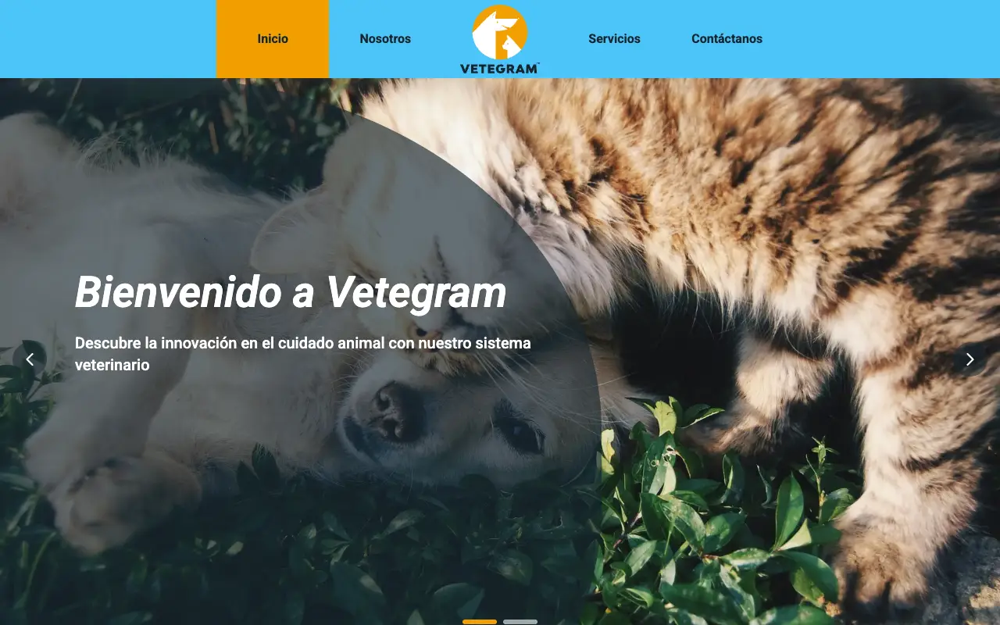
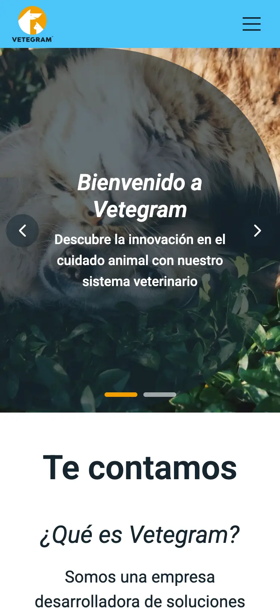

# Vetegram

Marketing site for Vetegram, a veterinary management platform, rebuilt in React and Tailwind CSS.

**[Live demo](https://vetegram-lavdesign.vercel.app)** · [](https://github.com/LavDesign/vetegram-react/actions/workflows/ci.yml)

## Overview

Vetegram develops technology for the veterinary sector in Costa Rica and Central America: a web platform for clinics to manage patients, medical records, appointments, e-invoicing, inventory and accounting reports. This single-page site presents the company and its services, and lets clinics get in touch.

It is a migration of the original static site (2024, HTML + Bootstrap 4 + jQuery) to React + Tailwind CSS, keeping the brand, content and layout while improving accessibility, performance and maintainability. The site content is in Spanish.

## Screenshots

| Desktop (1280 px)                                                                                                                                        | Mobile (375 px)                                                                                                                                                                  |
| -------------------------------------------------------------------------------------------------------------------------------------------------------- | -------------------------------------------------------------------------------------------------------------------------------------------------------------------------------- |
|  |  |

## Features

- **Header:** fixed, with a logo that shrinks on scroll, the active section highlighted as you scroll, and a hamburger menu on mobile (Escape closes it).
- **Hero:** 2-slide carousel with arrows, indicators, arrow-key navigation and animated captions.
- **About:** accordion (one item open at a time), animated images and 4 feature cards.
- **Services:** 5-card slider showing 3, 2 or 1 cards by width, with one indicator per card and the visible range announced to screen readers.
- **Contact:** form with inline validation, sent through Formspree or shown in demo mode, with a honeypot against spam.
- **Footer** with contact details and social links, plus a "Volver arriba" (back to top) button.
- **Accessibility:** skip link, visible focus on every control, keyboard support throughout, and no motion under `prefers-reduced-motion`.

## Tech stack

| Tool                                   | Version                       |
| -------------------------------------- | ----------------------------- |
| React                                  | 19.3.1                        |
| Vite + `@vitejs/plugin-react`          | 8.3.5 + 6.1.2                 |
| Tailwind CSS (`@tailwindcss/vite`)     | 4.3.3                         |
| lucide-react                           | 1.61.0                        |
| Roboto (`@fontsource-variable/roboto`) | 5.3.0                         |
| Vitest + Testing Library + jsdom       | 5.0.5 + React 16.3.3 + 30.1.3 |
| oxlint                                 | 1.89.0                        |
| Prettier                               | 3.9.10                        |

Versions are the ones installed from `package-lock.json`.

## Key decisions

- **Tailwind v4 with `@theme` and brand tokens:** all design tokens (`brand`, `accent`, `ink`, `ocean`, font) live in `src/index.css`, one source of truth with no JS config.
- **No React Router:** it is a single page with anchor navigation, so a router would add weight without adding anything.
- **Carousels with CSS scroll-snap, no library:** native swipe and scrolling, with a small shared `useCarousel` hook that reads the position back from the scroll.
- **Autoplay removed:** moving content hurts usability and needs a reliable pause control (WCAG 2.2.2), so both carousels are manual.
- **Contrast adjusted, palette kept:** for example, menu text is `ink` instead of white on `brand` (~2:1), and the contact box went from 50% to 85% opacity, so text meets WCAG AA in the original colours.
- **Form with demo mode and Formspree:** it works with no backend; it only sends when `VITE_FORMSPREE_ID` is set, so the public demo never sends messages by accident.
- **WebP images:** the original `images/` folder held 15.3 MB of JPG/PNG; the site now ships 12 WebP files totalling 0.89 MB, including the Hero photos the original loaded from Unsplash.
- **One indicator per Services card:** the dots match the cards, and every visible card is highlighted, measured from the scroll position rather than breakpoints.

## Quality

Lighthouse 12.8.2, median of 3 runs on `npm run build` + `vite preview` ([PR #7](https://github.com/LavDesign/vetegram-react/pull/7)). Scores are performance / accessibility / best practices / SEO.

|         | Before                         | After                            |
| ------- | ------------------------------ | -------------------------------- |
| Mobile  | 86 / 100 / 96 / 92 — LCP 4.1 s | 93 / 100 / 100 / 100 — LCP 3.0 s |
| Desktop | 99 / 100 / 96 / 92 — LCP 1.0 s | 99 / 100 / 100 / 100 — LCP 1.0 s |

- **axe-core 4.14** (WCAG 2.0/2.1/2.2 A + AA, full page at 375 and 1280 px): 1 serious violation → 0.
- **14 tests** with Vitest and Testing Library for the header menu, accordion and contact form.
- **CI** on every pull request and every push to `main`: format check, lint, tests and build ([`ci.yml`](.github/workflows/ci.yml)).
- **Protected `main`:** changes land only through a pull request with a passing CI check; force pushes and deletion are blocked.

## Getting started

Requirements: Node.js 24 (see [`.nvmrc`](.nvmrc)) and npm.

```bash
npm install
npm run dev           # http://localhost:5173
npm test              # Vitest, single run (npm run test:watch to watch)
npm run lint          # oxlint
npm run format:check  # Prettier
npm run build         # production build in dist/
npm run preview       # serve the build locally
```

### Contact form (optional)

Without configuration, the form runs in **demo mode**: it validates, but sends nothing and says so on screen. To receive real messages, create a form on [Formspree](https://formspree.io) and add its ID (the part after `/f/` in the endpoint) to `.env.local`, which git ignores:

```bash
VITE_FORMSPREE_ID=your_form_id
```

The ID ships in the browser bundle, so it is not a secret. See [`.env.example`](.env.example).

## Project structure

```text
src/
├── assets/          # logos, flag and WebP images
├── components/      # page sections and UI pieces, with their *.test.jsx
├── data/            # site content (copy, links, services) kept out of the components
├── hooks/           # useCarousel, useScrollSpy, useScrolled, useInView
├── test/setup.js    # Vitest + Testing Library setup
├── App.jsx
├── index.css        # Tailwind import, @theme tokens and animations
└── main.jsx
```

## Workflow

AI-assisted: product, design and technical decisions and code review by me; implementation with Claude Code.

Work was split into milestones, one branch and one pull request each, with a description, verification steps and measured results. CI must pass before merging into `main`.

## Learning outcomes

- **Directing AI still needs a designer's eye.** Reviewing every milestone in the browser, I caught issues the implementation missed: a pause button that seemed to do nothing, a missing pointer cursor, an abrupt hover, and slider dots that didn't match the number of cards.
- **Simpler beats clever.** Instead of fixing the confusing autoplay pause button, I removed autoplay entirely: better for users and for WCAG 2.2.2.
- **Accessibility can keep the brand.** I kept Vetegram's palette and changed text colors (dark text on sky blue and orange) to reach AA contrast.
- **Motion design principles work on the web.** The cat's jump uses anticipation, stretch and squash, and every animation respects reduced-motion settings.
- **Tailwind v4 is not v3.** Theme tokens live in CSS (`@theme`), buttons default to `cursor: default`, and `scale-*` uses the CSS `scale` property, which changes how transitions are written.
- **Process matters, even solo.** One branch and one pull request per milestone, CI on every PR, a protected `main` branch and Vercel previews made every change reviewable before going live.

## Future improvements

- Real copy for the About accordion and for Services cards 3 and 4 (they repeat Grooming and Marketplace, as in the original).
- Real Vetegram social profile URLs (the original used generic ones).
- Turn on Formspree in production.
- Replace the photos whose source isn't confirmed.
- Prerender the page to lower mobile LCP, which is now limited by client-side rendering.

## Credits

- **Hero photos** from Unsplash: [photo 1](https://images.unsplash.com/photo-1450778869180-41d0601e046e) and [photo 2](https://images.unsplash.com/photo-1623387641168-d9803ddd3f35).
- **Other photos:** stock photography carried over from the original site; source not recorded.
- [Lucide](https://lucide.dev) icons (ISC License).
- [Simple Icons](https://simpleicons.org) for the social logos (CC0 1.0).
- [Roboto](https://fonts.google.com/specimen/Roboto) via [Fontsource](https://fontsource.org) (SIL Open Font License 1.1).
- [Formspree](https://formspree.io) for form submissions.

## License

All rights reserved. See [LICENSE](LICENSE).
